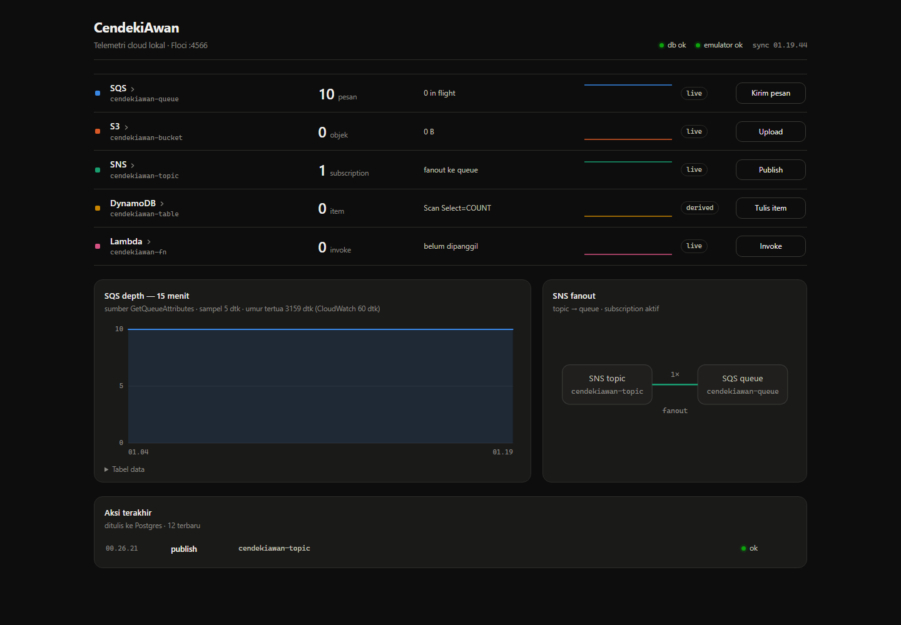
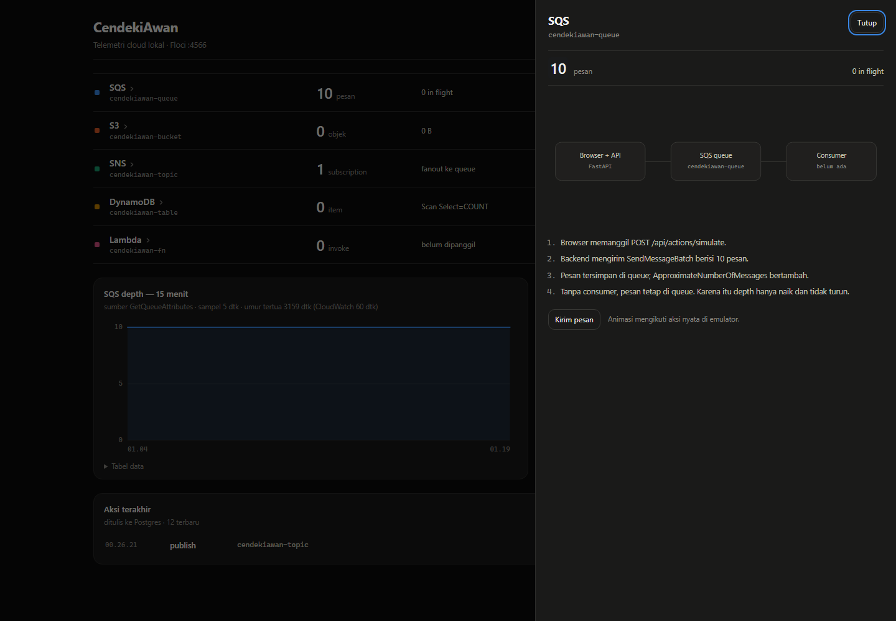
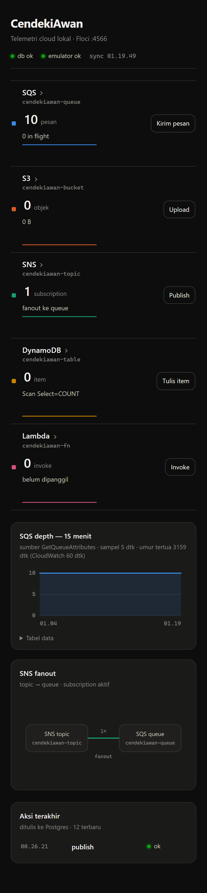

# CendekiAwan

Dashboard telemetri live untuk lima layanan AWS yang berjalan lokal di
[Floci](https://github.com/floci-io/floci), emulator AWS berlisensi MIT tanpa akun dan
tanpa auth token. Satu halaman dan satu perintah Docker Compose, tanpa biaya.

Lima layanan yang ditampilkan: SQS, S3, SNS, DynamoDB, dan Lambda.

## Masalah yang diselesaikan

Emulator AWS lokal hanya punya API dan CLI, jadi tidak ada cara cepat untuk melihat apakah
antrean bertambah, objek masuk bucket, atau Lambda terpanggil. CendekiAwan menampilkan
nilai terakhir setiap layanan, tren 15 menit, sumber data (`live`, `CloudWatch 60 dtk`,
atau `derived`), dan tombol aksi yang mengubah state emulator.

## Stack

| Lapisan | Teknologi |
|---|---|
| Frontend | React 19 + Vite 6, disajikan nginx |
| Backend | FastAPI + SQLAlchemy 2, Python 3.12 |
| Database | PostgreSQL 16 (named volume `pgdata`) |
| Emulator AWS | Floci 2.4.0 (S3, SQS, SNS, DynamoDB, Lambda) |
| Cache bonus | Redis 7.4 (TTL 2 dtk) |

## Arsitektur

```text
Browser :8080
   │
   ▼
frontend (nginx) ──/api──► backend (FastAPI :8000)
                              │        │
                              │        ├──► db (Postgres :5432)   [pgdata]
                              │        ├──► floci (:4566)         [flocidata]
                              │        └──► redis (:6379)        [rediscache]
                              └── retry loop saat startup
```

| Service | Image | Port host | Volume | Healthcheck |
|---|---|---|---|---|
| `frontend` | `nginx:1.27-alpine` (build) | `8080:80` | kosong | `wget /` |
| `backend` | `python:3.12-slim` (build) | internal `8000` | kosong | Python `urllib /health` |
| `db` | `postgres:16-alpine` | `127.0.0.1:5432` | `pgdata` | `pg_isready` |
| `floci` | `floci/floci:2.4.0` | `127.0.0.1:4566` | `flocidata` | bash `/dev/tcp` |
| `redis` | `redis:7.4-alpine` | internal `6379` | `rediscache` | `redis-cli ping` |
| `adminer` | `adminer:4.8.1` | `127.0.0.1:8081` | kosong | profile `tools` saja |

Aplikasi menghubungi database lewat nama service `db` di network `appnet`.

## Menjalankan

```bash
cp .env.example .env          # opsional; semua nilai punya default
docker compose up -d --build
```

Buka http://localhost:8080. Hentikan dengan `docker compose down`; data tetap tersimpan.

Tools database (opsional):

```bash
docker compose --profile tools up -d adminer   # http://localhost:8081
```

## Endpoint

| Method | Path | Fungsi | Status |
|---|---|---|---|
| GET | `/health` | DB + emulator + Redis | 200 / 503 |
| GET | `/api/snapshot` | state live 5 layanan (cache 2 dtk) | 200 |
| GET | `/api/metrics?minutes=15` | time series dari Postgres | 200 |
| GET | `/api/events?limit=50` | audit log | 200 |
| POST | `/api/actions/simulate` | kirim pesan ke SQS | 201 / 422 |
| POST | `/api/actions/publish` | publish SNS → fanout | 201 / 422 |
| POST | `/api/actions/upload` | taruh objek di S3 | 201 / 422 |
| POST | `/api/actions/item` | tulis item DynamoDB | 201 / 422 |
| POST | `/api/actions/invoke` | invoke Lambda | 201 / 422 |

## Alur demo

1. Buka halaman. Lima baris service terisi sekitar 5 detik setelah sampler pertama berjalan.
2. Klik "Kirim pesan". SQS depth naik 10 dalam 8 detik atau kurang, dan feed audit mencatat `simulate ok`.
3. Klik "Publish". SNS mengirim pesan ke queue dan depth naik lagi.
4. Klik "Invoke". Lambda berjalan di container dan durasinya muncul di baris.
5. Grafik SQS menampilkan perubahan nyata, bukan data contoh.
6. Klik nama service untuk membuka diagram cara kerjanya. Animasi berjalan saat aksinya dijalankan.

## Aksesibilitas dan perilaku UI

- Chart memakai sumbu waktu nyata dari `captured_at`, tick bulat, dan viewBox yang mengikuti lebar panel. Label sumbu tetap 11 px di mobile.
- Di layar ≤900 px, baris service tetap menampilkan status sekunder dan sparkline; badge sumber disembunyikan agar tidak berdesakan.
- Drawer mekanisme bisa ditutup dengan Esc, fokus terkunci di dalam dialog, dan kembali ke baris pemicu saat ditutup. Body tidak ikut scroll.
- Status header bertiga: `pending` (abu-abu) sebelum respons pertama, `ok` (hijau), dan `down` (merah). Baris down tidak diredupkan; latar diberi tint merah tipis agar teks tetap lolos kontras.
- Banner error membedakan kegagalan data dan aksi, punya tombol Coba lagi/Tutup, dan tidak hilang sendiri. Jika `/api/metrics` gagal, chart menampilkan data terakhir dengan label peringatan.
- `prefers-reduced-motion` menonaktifkan animasi CSS dan paket diagram; skip link, `:focus-visible`, `aria-label`, dan `theme-color` tersedia.

## Bukti verifikasi

Perintah dan output lengkap ada di [`docs/verification.md`](docs/verification.md):
`compose ps` lima sehat, curl 200/201, persistensi `down`/`up`, Redis hit, dan ukuran image.

## Screenshot







## Image Docker Hub

- [`bangdemon/cendekiawan-backend`](https://hub.docker.com/r/bangdemon/cendekiawan-backend), tag `1.0.0` dan `latest`
- [`bangdemon/cendekiawan-frontend`](https://hub.docker.com/r/bangdemon/cendekiawan-frontend), tag `1.0.0` dan `latest`

## Struktur repo

```text
cendekiawan/
  backend/    app/{config,db,models,schemas,emulator,sampler,cache,main}.py
              app/routers/api.py  tests/  Dockerfile
  frontend/   src/{App,api,chart,styles.css,components/*}  nginx.conf  Dockerfile
  docs/       lo1-analysis.md  verification.md  screenshots/
  docker-compose.yml  .env.example  README.md
```

## Analisis model layanan cloud (LO1)

Lihat [`docs/lo1-analysis.md`](docs/lo1-analysis.md) untuk profil proyek, tabel lima model
layanan (IaaS/PaaS/SaaS/BaaS/FaaS), dan analisis deployment public/private/hybrid/multi-cloud.

## Batasan

- UI di `8080`, emulator di `127.0.0.1:4566`, database di `127.0.0.1:5432`. Tidak ada
  autentikasi; proyek ini alat lokal dan tidak dimaksudkan sebagai layanan publik.
- Floci menerima kredensial apa pun. Nilai di `.env.example` bukan kredensial AWS asli dan
  tidak boleh diganti dengan yang asli.
- Perilaku mengikuti Floci. Metrik `ApproximateAgeOfOldestMessage` hanya tersedia lewat
  CloudWatch dan diperbarui sekali per menit; kartu menampilkan label sumbernya.
- DynamoDB item count dihitung dengan `Scan Select=COUNT` karena `DescribeTable.ItemCount`
  tidak dapat diandalkan. Tabel demo dibatasi kecil.
- Dashboard ini bukan pengganti observability produksi: tidak ada time-range picker,
  threshold/alert, anotasi event, atau export. Fokusnya demo lima layanan.

## Pengujian

```bash
cd backend && pytest        # 12 tes API
cd frontend && npm test     # 8 tes helper chart (node:test)
```

## Persistensi: `down` vs `down -v`

- `docker compose down`: container berhenti dan volume tetap ada. Data Postgres, Floci, dan
  Redis bertahan, sudah diuji dengan events 11 → 11, DynamoDB 5 item, S3 3 objek, dan
  SQS 26 pesan.
- `docker compose down -v`: named volume `pgdata`, `flocidata`, dan `rediscache` dihapus.
  Data demo hilang dan resource di-seed ulang saat start berikutnya.

## AI Usage Declaration

Claude Code dipakai untuk scaffold, implementasi backend dan frontend, penulisan tes,
konfigurasi Docker, serta penyusunan dokumen ini. Semua hasil dijalankan dan diperiksa di
mesin pengembang: `docker compose up -d --build`, `pytest` (12 tes), `npm test` (8 tes),
curl endpoint, uji persistensi, dan screenshot browser. Tidak ada kredensial asli yang
dipakai atau disimpan; nilai AWS di `.env.example` hanya dummy untuk emulator lokal.